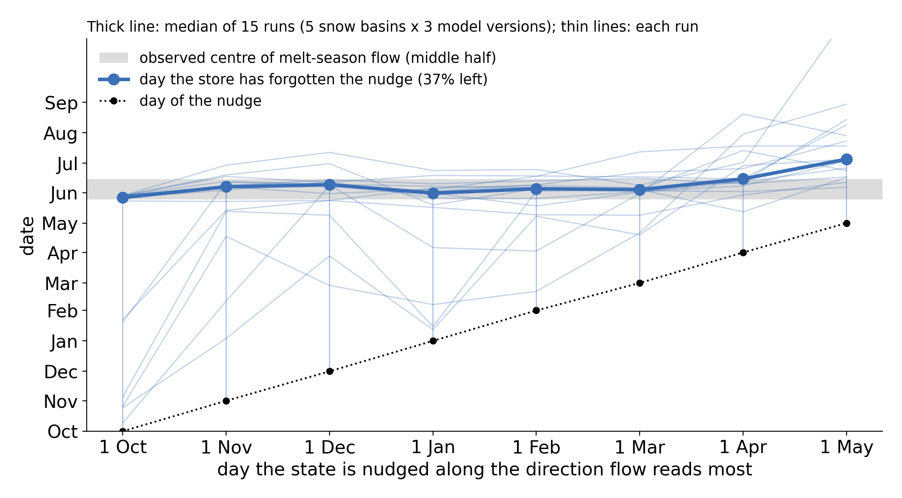

# Jacobian Interpretability of LSTM Memory Timescales

Code and figures for the AGU 2026 talk *Jacobian Interpretability of LSTM Memory Timescales* (Kaitlin Meyer, University of Utah).

Earlier work showed that snowpack can be **read** from the cell states of a streamflow LSTM (Kratzert et al., 2019; Lees et al., 2022). We ask whether what can be read is what the model **uses**, and how long the model holds it. We chain the model's daily Jacobians (partial derivatives of each day's state with respect to the day before) to measure how sensitive flow is to every part of the state, and how long a change in each part lasts.

**Findings** (one LSTM, three trained versions, five snow basins, water years 2009–2014):

1. **The snow is not where it looks like it.** Cells that track snow recover 2% of the effect of winter snowfall on melt-season flow; three directions in the state that flow is most sensitive to recover 96%.
2. **That store is held until melt.** Nudge it on any day from November to April and the nudge fades in early June, within about a week of the observed centre of melt-season flow.
3. **A long memory is not a used memory.** A linear snow probe direction remembers for months, but flow barely reads it; single cells and single forget gates forget within days to weeks.



## Quick start (no data needed)

Every analysis script has a `--toy` mode that runs on a small random LSTM, so you can check the code without the data or trained models:

```bash
conda env create -f environment.yml && conda activate neuralhydrology
PYTHONPATH=src python src/nb32_cell_memory.py --toy --horizon 60 --starts 12-01 03-01
```

## Repository layout

```
configs/        NeuralHydrology configs: the CAMELS benchmark LSTM (3 seeds) and the synthetic-catchment runs
basin_lists/    the 531 CAMELS basins
src/            scripts behind the main talk; each file's header says what it does and how to run it
src/backup/     scripts behind the backup slides
slurm/          batch jobs (account, partition and modules left for you to fill in)
notebooks/      a toy walkthrough of the Jacobian on a tiny LSTM
figures/        the figures used in the talk
```

`src/jtalk_core.py` holds the shared pieces: loading a trained NeuralHydrology model, running 365-day windows, and the forward and backward (chained) Jacobians.

## Figures and the scripts that make them

| Talk slide | Figure | Script |
|---|---|---|
| Where the five snow basins are | `basins_map.png` | `basins_map.py` |
| Does the tool recover a planted memory? | `fig_synthetic_two_panel_S2_same_axis.png` | `nb08a_generate_synthetic.py` → `make_syn_configs.py` → train (`slurm/slurm_train_syn.slurm`) → `nb08b_recovery.py` → `fig_synthetic_two_panel.py --same-axis` |
| One unit looks like a snowpack | `nb31_unit77_06623800_WY2011.png` | `nb31_fig_unit_three_panel.py` |
| Cells that track snow do not carry the snow | `nb29_recovered.png` | `nb27_read_directions.py` (one run per basin and seed) → `nb27_collect.py` → `nb29_fig_snow_store.py` |
| What flow reads is held until melt | `nb32_memory_end_date_full.png` | `nb32_cell_memory.py` → `nb32_collect.py` → `nb32_fig_memory.py --panels 3 --full` |
| Backup: memory against effect on flow | `nb32_memory_vs_flow_06623800_seed1_12-01.png` | `nb32_fig_memory.py --panels 2` |
| Backup: memory through the year | `nb32_memory_through_year.png` | `nb32_fig_memory.py --panels 1` |
| Backup: when vs how much (held-out probe) | `nb29_when_vs_how_much.png` | `nb28_read_directions_followup.py` → `nb29_fig_snow_store.py` |
| Backup: the model as a whole | `nb24_where_each_months_rain_goes.png`, `nb26_observed_lag.png` | `src/backup/nb24_…`, `nb23_all_basins_memory.py` → `nb26_observed_lag_snow_basins.py` |

## Reproducing the results

You need [NeuralHydrology](https://github.com/neuralhydrology/neuralhydrology), the CAMELS-US data set with Daymet forcing, and, for the snow comparisons, SPIReS snow water equivalent. Point the data paths in `configs/*.yml` (marked `<path-to>`) at your copies, and set `JTALK_ROOT` to the folder that holds `runs/`, `data/` and `analysis/` (default: this repository).

Run from the repository root with `PYTHONPATH=src`, in this order (each slurm file is the batch version of the step):

1. **Train** the benchmark LSTM, three seeds: `slurm/train_camels531*.slurm` (configs in `configs/`; trained on water years 2000–2008, analysed on 2009–2014).
2. **Synthetic check**: the synthetic chain in the table above.
3. **Snow reference**: `spires_extract_all.py` (`slurm/spires_all.slurm`).
4. **Whole-model memory and observed snow lag**: `nb23_all_basins_memory.py`, then `nb26_observed_lag_snow_basins.py` (its table gives the observed melt timing used in step 7).
5. **Unit 77**: `nb31_fig_unit_three_panel.py`.
6. **Where the snow is**: `nb27_read_directions.py` (15 runs: 5 basins × 3 seeds) → `nb27_collect.py` → `nb28_read_directions_followup.py` → `nb29_fig_snow_store.py`.
7. **How long it is held**: `nb32_cell_memory.py` (15 runs) → `nb32_collect.py` → `nb32_fig_memory.py`.

Backup-slide analyses are in `src/backup/`; `nb30_snow_cells_role.py` needs step 6's outputs.

Trained model weights are not in this repository; they are available on request.

## Scope

One LSTM architecture (256 units, NSE loss) trained on 531 CAMELS basins, three random seeds. Snow results come from five snow basins (Encampment R., WY; Middle Cr., CO; White R., UT; SF Payette R., ID; Newhalem Cr., WA). The memory end date matches the typical melt date but does not rank years by melt timing. Using the directions found here to correct the model's snow with observations is an implication, not something tested here.

## References

- Kratzert, F., et al. (2019). Towards learning universal, regional, and local hydrological behaviors via machine learning applied to large-sample datasets. *Hydrology and Earth System Sciences*.
- Lees, T., et al. (2022). Hydrological concept formation inside long short-term memory (LSTM) networks. *Hydrology and Earth System Sciences*.
- Tallec, C., & Ollivier, Y. (2018). Can recurrent neural networks warp time? *ICLR*.

## Contact

Kaitlin Meyer · github.com/kaitlin-merimee/lstm-jacobian-memory
